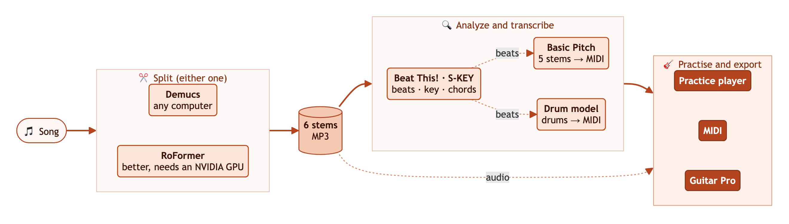
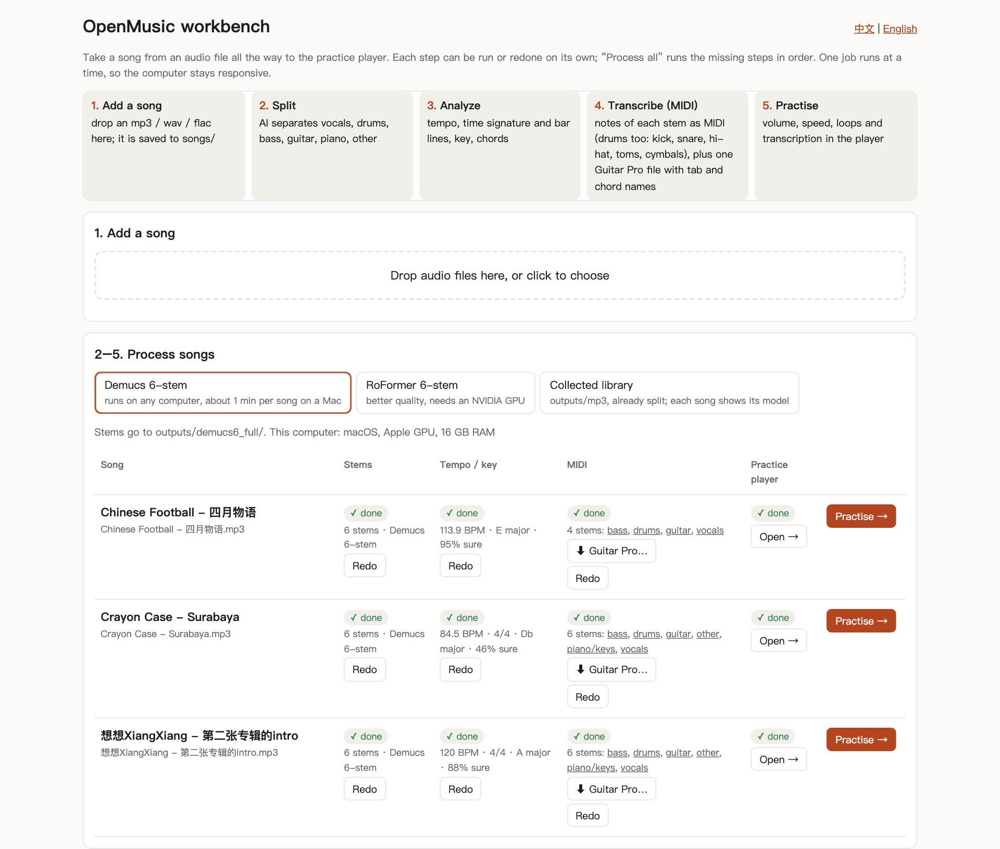
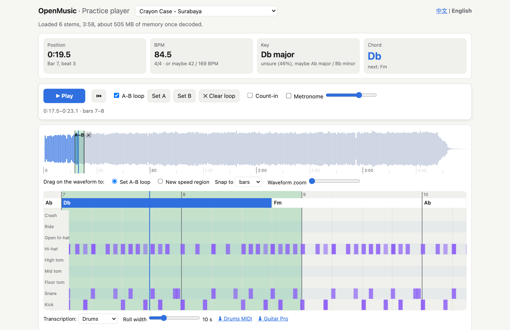
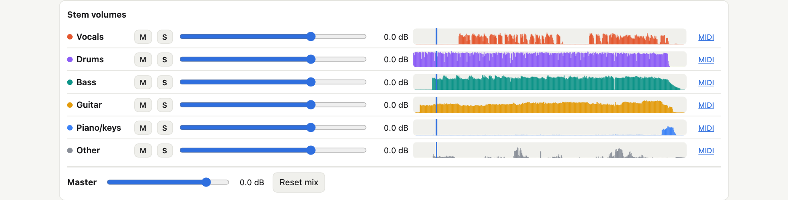

# OpenMusic

[中文](README.md) | **English**

> 本项目使用中文作为默认语言，同时也为英文使用者做了语言适配：英文说明见 [README.en.md](README.en.md)，工作台和练习播放器网页的右上角也可以进行自由的双语切换「中文 / English」。
>
> This project uses Chinese as its default language and also supports English: see [README.en.md](README.en.md) for the English README, and switch the language of the workbench and practice-player pages with "中文 / English" at the top right.

OpenMusic is an open-source tool for musicians to **practise** and **transcribe** songs: it splits a song into 6
stems (vocals / drums / bass / guitar / piano / other), and a **local HTML page** is where you work with them:
adjust the volumes, slow down, loop, follow the chords, get MIDI… (more is to come; feedback is welcome) It
is written in Python and runs locally on your own computer; there is no mobile version yet, and no hosted web
version.

Right now it already helps a lot with separating the **vocals** and transcribing their melody, and with
transcribing the **bass**, **keys** and **drums**: put in an MP3 and you get, more or less automatically, a Guitar
Pro score. **Guitar** transcription, though, is so far limited to extracting the guitar's sound and analysing each
bar's chord (and the song's key); the actual notes still have to be worked out by ear, but this already saves a
lot of effort!

OpenMusic is developed with the help of Claude Code. At its core is an analysis pipeline: it chains excellent
open-source tools and pre-trained models from GitHub (separation, beats, key, transcription), and adds a drum
transcription model we trained ourselves, a Guitar Pro export and a practice player, **taking a song from audio
all the way to a score you can practise with and read**. The project is at a very early stage; next we plan to
look into separating several guitars (e.g. lead and rhythm guitar). Interested developers are very welcome to join
in: stars, forks, issues and pull requests are all appreciated 🤝

## How it works



In short: the [**workbench**](#workbench) runs these steps in a row, one click on "**Process all**" per song; each
step can also be redone on its own, or run in a terminal (see "[**Practice player**](#practice-player-for-practising-and-transcribing)" below).

- **Step 1: split the song into stems.** The song's audio file goes in, and a separation model,
  [Demucs](https://github.com/adefossez/demucs) 6-stem (runs on any computer) or
  [BS-RoFormer-SW](https://huggingface.co/enerjazzer/BS-ROFO-SW-Fixed) 6-stem (better; an NVIDIA GPU is
  recommended, about 20 s per song on an RTX 4070 Ti; it also runs on a Mac, but slowly and with over 6 GB of
  memory), splits it into 6 MP3s: **vocals**, **drums**, **bass**, **guitar**, **piano/keys** and **other**.
  Splitting only reads the original audio file, and every later step only **reads** the stems (a Guitar Pro export
  with "Original" reads the original file as it is); nothing changes any audio.
- **Step 2: analyse the stems.** [Beat This!](https://github.com/CPJKU/beat_this) finds the beats and bars,
  [S-KEY](https://github.com/deezer/skey) together with key profiles the key, and template matching + the
  [Viterbi algorithm](https://en.wikipedia.org/wiki/Viterbi_algorithm) the chords.
- **Step 3: transcribe the stems.** [Basic Pitch](https://github.com/spotify/basic-pitch) turns the 5 pitched
  stems (**vocals**, **bass**, **guitar**, **piano/keys** and **other**) into MIDI; the **drums** go through the
  built-in drum model, or the optional plugin [ADTOF-pytorch](https://github.com/xavriley/ADTOF-pytorch) (better,
  but its model weights are for non-commercial use only, which does not fit this project's AGPL-3.0, so it is not
  shipped with the project; the install steps are in "[Optional plugin](#optional-plugin-adtof-pytorch-drum-transcription)",
  and once installed it is used automatically). The project then writes the transcription as a
  [Guitar Pro](https://www.guitar-pro.com/) file, so once the MIDI is done the score is one click away (see
  "[Guitar Pro file](#guitar-pro-file)"). The MIDI uses the **beats** and **bar lines** from **step 2** (the dashed
  "beats" lines), so the bar lines of the MIDI, the Guitar Pro file and the practice player line up. Only the bit
  before the song's first downbeat (a pickup) is bar 0 in the player and bar 1 in the MIDI and Guitar Pro, so
  their bar numbers are usually one higher than the player's (see "[Guitar Pro file](#guitar-pro-file)").
- **Step 4: practise and export.** The practice player plays the stems' audio: besides each stem's volume, mute
  and solo it has loops, speed changes and more (see "[**Practice player**](#practice-player-for-practising-and-transcribing)"),
  all to make practising easier! A Guitar Pro export can also carry a mix of stems as an audio track, chosen when
  you download it, by default vocals + guitar + other (the dashed "audio" line).

## The easiest way to start 🚀
1. Open your favourite AI agent (e.g. ChatGPT Work, Claude Code, Cursor, OpenCode, WorkBuddy, DeepSeek Harness,
   ZCode, Kimi Code).
2. Send it [this project's GitHub link](https://github.com/Lihan-Zhong/OpenMusic/tree/main) and and type: 🔍
    > Please read this GitHub project: https://github.com/Lihan-Zhong/OpenMusic/tree/main
    > Following its documentation, clone the repository, set up the environment, install the dependencies and run it for the first time.
3. Follow the agent's guidance for any permissions or confirmations it asks for: it clones this repository,
   downloads and installs the dependencies, and installs the plugin
   [ADTOF-pytorch](https://github.com/xavriley/ADTOF-pytorch) (optional; its model weights are for non-commercial
   use only) for the full power 🔥
4. Double-click **`OpenMusic.command`** in the project folder (on Windows, **`OpenMusic.bat`**), and it starts
   right away 🚀

💡 Tip: if you prefer to install by hand, clone the repository yourself and follow
"[Starting by hand](#starting-by-hand)" below.

## Starting by hand

1. Set up the environment as in "[Installation](#installation)" below.
2. Open the workbench: double-click **`OpenMusic.command`** in the project folder in Finder (on Windows,
   **`OpenMusic.bat`**). A terminal window opens and your browser shows http://localhost:8780 ; if the workbench is
   already running, it is just opened in the browser. In a terminal, `.venv/bin/python experiments/app.py` does the same.
3. Drop an mp3 into the page, choose a separation model, click "Process all", then "Open" to go to the practice player.

## Everyday use
- Just put the songs you want to process into the `songs/` folder; they show up in the workbench within a few
  seconds. With several new songs, choose the separation model, then click "Process all (n not finished)" above
  the list: they are processed one after another, one job at a time.
- The stems are MP3 (about 15-70 MB per song for 6 stems plus analysis, MIDI and the Guitar Pro file); for lossless
  FLAC, run `.venv/bin/python experiments/evaluate_multi.py demucs6 --full --no-score --lossless` in a terminal
  (`roformer_sw` instead of `demucs6` for RoFormer; the workbench has no such option).
- When you are done, close the terminal window (or press Ctrl+C in it) and the workbench stops; a job that was
  running stops too: next time click "Run" on the step that was cut short ("Redo" if the step had been done
  before), then "Process all" for the steps after it.
- Drag `OpenMusic.command` to the right side of the Dock, or put an alias of it on the desktop, to open it with
  one click. If you downloaded the project as a zip from GitHub, macOS may refuse to open it the first time: click
  "Open Anyway" in System Settings → Privacy & Security (on older macOS versions you can also Control-click it and
  choose "Open").

## Workbench

The workbench puts the whole flow in one web page. Each step can be run or redone on its own, and only one job
runs at a time so the computer stays responsive:



1. **Add a song**: drop an <mark>**mp3** / **wav** / **flac**</mark> in (m4a, aac and ogg work too, up to 400 MB
   per file); it is saved to `songs/`.
2. **Split**: choose a model (see "[Choosing a separation model](#choosing-a-separation-model)" below) to get 6
   stems. Each song records which model split it.
3. **Analyze**: tempo (beats, time signature, bar lines), key, chords.
4. **Transcribe (MIDI)**: every stem becomes notes you can import into Guitar Pro / [MuseScore](https://musescore.org/)
   (the drums too, as a drum part), plus one Guitar Pro file of the whole song ("⬇ Guitar Pro…" lets you choose
   its audio track; see "[Guitar Pro file](#guitar-pro-file)" below).
5. **Practise**: "Open" goes to the song's practice player; the top left of the player leads back to the workbench.

The "Collected library" tab holds songs that are already split (`outputs/mp3/`) and starts at step 3. The
workbench runs only on this computer (127.0.0.1); its buttons run the same commands as in the
"[Practice player](#practice-player-for-practising-and-transcribing)" section.

## Practice player (for practising and transcribing)

Once a song is split into stems, practise with it in a local web page:





- **Per-stem volume** from −∞ to +12 dB, so the bass can be louder than in the original; mute and solo; a
  master limiter so boosting never clips.
- **Tempo, key and chords**: detected BPM, every beat and bar line; the key with a confidence, and when that is
  under one half, one or two other candidates (often the relative major/minor); a chord lane on the timeline
  showing the current and next chord.
- **Speed change without pitch change**, 50%–150%; drag across the waveform to give a passage its own speed,
  e.g. 70% for the hard part. Pitch shift in semitones and cents.
- **Practice tools**: A-B loop (drag across the waveform, or press "Set A" and "Set B" while listening, snapped to
  the nearest bar line by default; Esc, the ✕ or a double-click on the loop clears it), a speed trainer (by
  default from 70%, 5% faster every loop, up to 100%, all adjustable; back to your speed when you switch it off),
  count-in, and a metronome that clicks on the song's own beats. Settings are kept per song in this browser (the
  workbench and `http.server` are different addresses, each keeps its own); when you reopen a song the page says
  what came back, and "Reset this song" (after asking) resets the loop, speed regions, speed, pitch, volumes,
  metronome and count-in.
- **Transcription**: every stem is turned into MIDI; the page shows a piano roll with note names and the notes
  sounding now. The MIDI carries the song's tempo changes and has exactly the player's beats and bar lines, so
  bars line up when imported into Guitar Pro or MuseScore. Bass is the most accurate; guitar and piano are
  dense rough drafts. When the note model is unsure about a whole stem (a very low synth bass, a heavily
  distorted guitar), that stem's thresholds are lowered for that song, so whole passages are not left without
  notes. Below the piano roll there is also the whole song as a Guitar Pro file.
- **Drums**: the drum stem becomes a [General MIDI](https://en.wikipedia.org/wiki/General_MIDI) drum track (kick,
  snare, closed and open hi-hat, three toms, crash, ride); choose "Drums" in the note view to see one row per kit
  piece. Kick and snare are the most accurate (**F-score** about 0.9 / 0.8
  on real recordings split from the mix), hi-hat is a draft, toms and cymbals are hints; with the optional
  ADTOF-pytorch plugin (see "[Optional plugin](#optional-plugin-adtof-pytorch-drum-transcription)" below) hi-hat
  and cymbals are much better. How it works, the options we looked at and the scores are in
  [docs/drums.en.md](docs/drums.en.md).
- **Shortcuts**: space play/pause, L loop on/off, A / B set loop start / end, Esc clear loop, `[` `]` speed
  −/+5%, ← → previous / next bar line (2 s without analysis), M metronome, Home back to start (to A while a loop
  is on).

The workbench above is the easiest way. You can also run the steps one by one in a terminal (with RoFormer
stems; every song in `songs/` is processed):

```bash
.venv/bin/python experiments/evaluate_multi.py roformer_sw --full --no-score
.venv/bin/python experiments/analyze.py outputs/roformer_sw_full
.venv/bin/python experiments/transcribe.py outputs/roformer_sw_full
.venv/bin/python experiments/export_gp.py outputs/roformer_sw_full
.venv/bin/python experiments/build_player.py outputs/roformer_sw_full
.venv/bin/python -m http.server 8765
```

Then open http://localhost:8765/outputs/roformer_sw_full/player.html (English: player.en.html; the pages also
switch language).

- It must be served over a local server (the workbench or `http.server`): opened by double-clicking the HTML file
  (a file:// address), the browser won't run the player's audio processing modules.
- The first command splits the songs (`--no-score` skips [MUSDB18](https://sigsep.github.io/datasets/musdb.html)
  scoring, so no test data is needed); the second detects tempo, key and chords; the third makes MIDI; the fourth
  writes the Guitar Pro file; the fifth builds the pages.
- Detection is a guide: in noise or rubato passages the beat tracker loses the beat; the grid there is evened out
  into steady bars at the tempo around it, which may not sit exactly on the music. Key and chords are right
  roughly 70–80% of the time, and chord extensions (7, sus, ...) are hints.
- A 6-minute song with 6 stems uses about 1.5 GB of browser memory.

## Guitar Pro file

After the MIDI step the workbench writes the whole song as a score, `<song>/transcription/<song>.gp` (Guitar
Pro 8's .gp format, see below for Guitar Pro 7; Chinese titles show correctly), so there is no need to import the
MIDI files one by one and tidy them up. "⬇ Guitar Pro…" is in the workbench's MIDI column and in the practice
player (below the piano roll, when opened from the workbench): choose the audio track for the file, click "Build
and download", and a few seconds later it is in the browser's downloads; no extra copy is kept in the project. In
a player opened through `http.server` it is a link that downloads the stored score (default audio track).

- **Tracks**: guitar (6 strings, standard tuning by default, tab + notation), bass (standard 4 strings by default,
  tab + notation), the vocal melody (notation only); piano and other only when they have enough notes; drums when
  there is a drum transcription (`transcription/drums.mid`).
- **Bars**: the same beats and bar lines as the MIDI and the player, with each bar's time signature from its
  detected number of beats. When the song starts with less than a full bar (a pickup), that bar is bar 1 in
  Guitar Pro and bar 0 in the player, so later bar numbers are one higher than in the player. If the first beat
  comes less than half a beat in (say a few hundredths of a second), the score leaves no beat for that sliver and
  starts at the first beat, and the audio track skips it; otherwise Guitar Pro would play the sliver as a whole
  beat and the MIDI tracks would run a beat behind the recording. Guitar Pro keeps one whole-number tempo at a
  time: the score follows the per-bar tempo (a median over 5 bars) and marks a new tempo when it differs from the
  written one by more than 3 %. With the song's audio track in the file, its sync points set the playback tempo,
  so the score follows the recording.
- **Rhythm**: notes go on a grid of 16ths, or of 8th-note triplets in beats that are clearly triplets; a quick
  double stroke on the drums (two hits of one drum about a 32nd apart) is written as two 32nds, not merged into
  one. Notes that start together form a chord, held at most until the next note starts; gaps under half a beat
  (a beat for the vocal melody) are closed, so there are fewer stray rests.
- **Frets**: every playable fingering of each chord is listed (one note per string, the fretting hand spanning at
  most 4 frets on guitar and 3 on bass), and a **dynamic programming**
  algorithm picks the path over the whole song with the least hand movement and no crossed strings (a higher note on a
  thicker string than a lower one), position changes being cheaper after long notes, and slightly prefers low
  positions. Notes that cannot be played together lose the softest first. When at least 8 notes, and 1 % of them,
  lie one or two semitones below the lowest string (D, D#), guitar or bass switches to drop D.
- **Clean-up**: notes softer than 55 % of the track's loud notes (95th percentile) are dropped (not on drums); on
  guitar, piano and other, so are overtone "ghosts": notes an octave, a twelfth, two octaves, ... (up to the 6th
  harmonic) above a note sounding at the same time, under 80 % of its loudness and overlapping it for at least
  half their length.
- **Chords, key, title**: the detected chord names sit above the staff; title, artist, key and tempo are in the
  file's score information.
- **The audio track (your choice)**: the file carries a recording as a Guitar Pro 8 audio track. By default it is
  a mix of the **vocals, guitar and other** stems: the bass, drums and vocal-melody MIDI are accurate, so Guitar
  Pro plays them, while the guitar has to be worked out by ear, so you hear the real recording. When you download
  you can instead pick any stems to mix, the whole original song (the file in `songs/`, as it is, not re-encoded;
  without one, or in a format Guitar Pro 8 does not read such as .aac, all stems are mixed instead), or no audio
  (the smallest file, about 0.1 MB); your last choice is remembered in this browser. A sync point at the start of
  every bar, taken from the detected bar lines, puts every bar at the same place as in the player (with a pickup
  the numbers differ by one, see above), and the score plays along with the recording (tried in Guitar Pro 8 on a
  Mac). A stems mix is turned down as a whole so that its peak stays under −1 dBFS (never up), so it never clips.
  Command line: `export_gp.py <library> --song <song> --audio stems --stems vocals,guitar,other` (the default),
  `--audio original` for the song, `--audio none` for none; `--out <file>` writes elsewhere and leaves the song
  folder alone.
- **Guitar muted**: the guitar transcription is busy, so its track starts muted (the tab shows as usual); bass,
  drums and vocals play. Unmute it in Guitar Pro's mixer.
- **No sound from the audio track?** First import any audio into Guitar Pro 8 yourself: usually it is the audio
  output. With Bluetooth headphones (AirPods) Guitar Pro 8 played nothing at all here, and the computer's
  speakers worked. The red headphones on the audio track's row are Solo: while it is on, the other tracks are
  silent.
- It is still a draft: bass is the most accurate, guitar is dense; check it by ear. The file keeps the song's name
  (a download adds the chosen audio, e.g. "<song> (vocals guitar other).gp"); track and chord names are plain ASCII.
- How: [PyGuitarPro](https://github.com/Perlence/PyGuitarPro) lays the score out in memory;
  [alphaTab](https://github.com/CoderLine/alphaTab) (included in `experiments/vendor/alphatab/`, run inside Python
  by [mini-racer](https://github.com/bpcreech/PyMiniRacer), so no Node.js or browser is needed) writes it as the
  .gp, which is read back to check the title, bars, tempo, every track's notes, the muted tracks, the audio track
  and every sync point. The older .gp5 format is not used: Guitar Pro reads its text in a single-byte code page
  (also on a Mac), so Chinese titles would come out garbled.
- Guitar Pro 7: the file is in the Guitar Pro 8 format (as everything alphaTab exports), and Guitar Pro 7 has no
  audio track, so it cannot show the one in the file. Going by the minimum version written in the file, the
  latest Guitar Pro 7 should open the score, but this has not been tried (there is no Guitar Pro 7 here); if it
  fails, write the score without audio with `--audio none`.

On its own: `.venv/bin/python experiments/export_gp.py outputs/mp3 --song "<song>"` (add `--force` when changing
the audio, e.g. only the vocals: `--audio stems --stems vocals --force`).

## Choosing a separation model

The workbench offers two separation models:

| Model | How cleanly it separates (SDR on MUSDB18 test clips, higher is better) | Speed | Advice |
|---|---|---|---|
| BS-RoFormer-SW 6-stem | 10.3 dB on average (vocals 12.0, drums 11.9, bass 9.4, other\* 8.0) | about 20 s per song on an RTX 4070 Ti; slow on a Mac and needs over 6 GB of memory | first choice with an NVIDIA GPU |
| Demucs 6-stem | 7.8 dB on average (vocals 8.6, drums 9.5, bass 8.3, other\* 4.8) | about 20 s for a 4-minute song on a Mac (M2 Pro), not counting loading the model and writing the files | runs on any computer |

\*"Other" is the guitar, piano and other stems added up, scored against MUSDB18's "other"; the average is over
the four. MUSDB18 has no separate guitar or piano ground truth, so those two can only be compared by ear. The
full experiment notes (the scores of the six classical signal-processing methods and the AI models, and how to
build the comparison listening pages locally) are in [docs/experiments.en.md](docs/experiments.en.md).

## Comparison with Ultimate Vocal Remover (UVR)

[UVR](https://github.com/Anjok07/ultimatevocalremovergui) is the most popular open-source stem separation app. This compares only what each project is for (as of October 2026):

| | UVR | OpenMusic |
|---|---|---|
| Purpose | A separation workstation: produce high-quality stem files with many models, for mixing, covers and production | A practice tool: split a song, then mute, solo and compare the stems in a local web page, for musicians practising |
| Form | Desktop app with installers for Windows / macOS / Linux | Python + local web pages (workbench + practice player) |
| Models | Many architectures (VR, MDX-Net, MDX23C, Demucs and more), mostly trained by the UVR developers apart from Demucs | Demucs 6-stem and BS-RoFormer-SW 6-stem (plus a comparison experiment with classical signal processing) |
| Combining models | Yes (Ensemble) | Fusion of the classical methods (`combo`); none yet for the AI models |
| Quality evaluation | Listening by the user | Built-in scoring (SDR on MUSDB18 test clips) and comparison listening pages, see the [experiment notes](docs/experiments.en.md) |
| Speed / pitch change | Tools based on [Rubber Band](https://breakfastquay.com/rubberband/) that process and write new files | Adjusted in real time during playback, with different speeds for different passages |
| Guitar | One guitar stem via Demucs 6-stem; no model that splits several guitars | Likewise one guitar stem (Demucs 6-stem or RoFormer-SW) |
| Practice and transcription aids | None | Per-stem boost, A-B loop, metronome; detected tempo, key and chords; per-stem MIDI with a piano roll; the whole song as a Guitar Pro file |
| Output | Stem files | Stems (MP3 by default for finished stems, lossless FLAC for comparison), plus per-stem MIDI, the whole song as a Guitar Pro file, and the practice player page |
| Licence | MIT code (credit UVR when using its models) | AGPL-3.0 |

The two complement each other: for the most models and the best possible stem files, use UVR; to practise and transcribe right after splitting, and compare methods objectively, use OpenMusic.

## Layout

```
OpenMusic.command     double-click to start the workbench (macOS); OpenMusic.bat is the Windows one
experiments/
  app.py              the workbench: a local web page that takes a song step by step to the practice player
  common.py           paths, audio I/O, SDR scoring
  prepare_data.py     decode the MUSDB18 sample into 3-stem ground truth (data/gt/)
  prepare_bass.py     add bass ground truth
  make_excerpts.py    split each full song with Demucs and cut a 60 s listening excerpt
  evaluate.py         score a 3-stem method: python experiments/evaluate.py <method> --split test --song
  evaluate_multi.py   score a multi-stem model, and split whole songs (the workbench's "Split" runs it): python experiments/evaluate_multi.py <model> --split test --song --full
  verify_scores.py    re-score methods from scratch and compare with the stored results
  export_mp3.py       convert existing lossless stems (WAV/FLAC) to MP3, keeping the folder layout
  oracle.py           the ceiling (ideal ratio mask)
  build_page.py       build the listening pages compare.html (Chinese) and compare.en.html (English)
  analyze.py          detect tempo (beats, bars), key and chords; writes analysis.json
  transcribe.py       turn each stem into MIDI and a note list (transcription/)
  drums.py            drum stem to drum hits: onsets, then a small neural network names the kit pieces
  train_drums.py      train and score the drums.py model (E-GMD, synthetic drums; scored on MDB Drums)
  drum_synth.py       synthetic drum kits and grooves: the drum test and part of the training data
  models/             model weights we trained ourselves: drums.npz
  export_gp.py        put the stems' transcriptions into one Guitar Pro file (transcription/<song>.gp)
  gp7.py              write the Guitar Pro 7/8 .gp with alphaTab, and read it back
  build_player.py     build the practice player player.html (Chinese) and player.en.html (English)
  tests/              automated tests for analysis, transcription, drums, the Guitar Pro export and the player
  vendor/             third-party code included as is, each with its LICENSE: Signalsmith Stretch, wavesurfer.js, S-KEY, alphaTab
  methods/            3-stem methods, one file per method with separate(mix, sr); *_fit.py fit parameters on training clips into *_stats.npz
  methods_multi/      multi-stem AI models: demucs4, demucs6, roformer_sw
results/              each method's scores (JSON) and experiment notes in method_info.json
docs/                 experiment notes (the separation comparison, drums to MIDI) and how to reproduce them, in Chinese and English; flow/ is the README's diagram (made by render.py), screenshots/ its screenshots (made by shoot.py)
```

Not in the repo (see `.gitignore`): `.venv/`, `.cache/` (model weights), `data/` (dataset),
`songs/` (your music), `outputs/` (separated stems), `plugins/` (optional plugins you install yourself), and the generated listening pages `compare.html` and `compare.en.html`.

## Installation

Python 3.12 or newer (the numpy, scipy, librosa, ... versions pinned in requirements.txt need 3.12; tested with 3.12.8).

macOS / Linux:
```bash
python3 -m venv .venv
.venv/bin/pip install -r requirements.txt
.venv/bin/pip install --no-deps -r requirements-nodeps.txt
```

Windows with an NVIDIA GPU (e.g. RTX 4070 Ti): first run the first line below to create `.venv`, then pick your
CUDA version on [PyTorch's install page](https://pytorch.org/get-started/locally/) and run the command it gives
with `pip3` replaced by `.venv\Scripts\python -m pip` to install a CUDA build of torch, and finally run the other
two lines for the rest:
```bash
python -m venv .venv
.venv\Scripts\python -m pip install -r requirements.txt
.venv\Scripts\python -m pip install --no-deps -r requirements-nodeps.txt
```
Check the GPU afterwards: `.venv\Scripts\python -c "import torch; print(torch.cuda.is_available())"`
should print `True`. The separation models pick a device in the order CUDA → Apple MPS → CPU (beat, key and
MIDI detection run on the CPU).

The last install line adds basic-pitch (MIDI transcription) without its dependencies: it pins TensorFlow
versions that don't exist for Python 3.12, and the ONNX path we use needs no TensorFlow at all. `pip check`
then reports basic-pitch's dependencies as missing (3 lines on macOS, 2 on Windows / Linux); that is expected.
`requirements-dev.txt` (Playwright) is only needed for the player's automated tests or to redraw the README's
diagram and screenshots (`docs/flow/render.py`, `docs/screenshots/shoot.py`); install notes are in the file.

The commands below use macOS paths; on Windows replace `.venv/bin/python` with `.venv\Scripts\python`.

Model weights download to `.cache/` on first use (Demucs 6-stem about 55 MB, the 4-stem htdemucs used to reproduce the
experiments about 85 MB, RoFormer-SW about 700 MB, Beat This! for the beats about 8 MB).

**Stem file formats:**
- Full-song stems (`--full`) are the finished product for practice and default to **MP3** (VBR about V2, roughly 1/3 the size of lossless, no audible difference). Add `--lossless` to get FLAC.
- The 60 s comparison excerpts (`--song`) are **always lossless FLAC**, because compression artifacts would blur the differences between methods.
- To convert existing lossless stems to MP3: `.venv/bin/python experiments/export_mp3.py <lossless stems folder> <output folder>`.
- Stems in every format are sample-exact in length, so they stay in sync when played together.

To reproduce the separation comparison (it needs the MUSDB18 test data), see [docs/experiments.en.md](docs/experiments.en.md).

## Optional plugin: ADTOF-pytorch drum transcription

OpenMusic's own drum model needs nothing extra (see [docs/drums.en.md](docs/drums.en.md)). For more accurate
drum parts you can install a plugin yourself: [ADTOF-pytorch](https://github.com/xavriley/ADTOF-pytorch), Xavier
Riley's PyTorch port of the ADTOF drum transcription model by Zehren et al. Once it is installed, `transcribe.py`
and the workbench use it to find the drum hits, and OpenMusic's own model refines them (which tom, open or closed
hi-hat, crash or ride) and estimates the velocities. The result goes into the same `drums.mid`, and
`drums.notes.json` says `"backend": "adtof-pytorch"`.

**It is more accurate**: on real recordings ([MDB Drums](https://github.com/CarlSouthall/MDBDrums) test half, drums split from the mix by Demucs), F-measure
(ADTOF's weights may have seen MDB Drums in training, so the plugin's scores may be a little high; see
[docs/drums.en.md](docs/drums.en.md)):

| | Kick | Snare | Hi-hat | Toms | Cymbals | Ride |
|---|---|---|---|---|---|---|
| Built-in model | 0.90 | 0.82 | 0.64 | 0.16 | 0.49 | 0.43 |
| ADTOF-pytorch plugin | 0.94 | 0.83 | 0.79 | 0.30 | 0.83 | 0.74 |

On e-drum recordings ([E-GMD](https://magenta.tensorflow.org/datasets/e-gmd)) the built-in model is better, and on synthetic drums the two are about even; see
[docs/drums.en.md](docs/drums.en.md).

**Licence, please read first**: ADTOF-pytorch is not part of OpenMusic, is not distributed with it and is not in
the repository (`plugins/` is in `.gitignore`). OpenMusic only runs its command line in a separate process and
reads the MIDI file it writes; it does not import its code. Its repository has no LICENSE file yet; in
[issue #3](https://github.com/xavriley/ADTOF-pytorch/issues/3) the author says the code will be MIT and the
model weights, derived from the original ADTOF, remain [CC BY-NC-SA 4.0](https://creativecommons.org/licenses/by-nc-sa/4.0/),
that is, **non-commercial use only**. Whether and how you use it is your decision, and complying with its licence
is your responsibility; this is not legal advice.

**Install** (run in the OpenMusic folder; about 1 GB to download, mostly PyTorch):

macOS / Linux:
```bash
git clone https://github.com/xavriley/ADTOF-pytorch plugins/ADTOF-pytorch
python3 -m venv plugins/ADTOF-pytorch/.venv
plugins/ADTOF-pytorch/.venv/bin/pip install -e plugins/ADTOF-pytorch
```

Windows:
```bash
git clone https://github.com/xavriley/ADTOF-pytorch plugins\ADTOF-pytorch
python -m venv plugins\ADTOF-pytorch\.venv
plugins\ADTOF-pytorch\.venv\Scripts\python -m pip install -e plugins\ADTOF-pytorch
```
With an NVIDIA GPU you can first install a CUDA build of torch into this venv (see
[PyTorch's install page](https://pytorch.org/get-started/locally/)); it is not needed, on the CPU a song takes a few seconds.

- Installed somewhere else: set the environment variable `OPENMUSIC_ADTOF` to the full path of its `adtof`
  command (on Windows `...\Scripts\adtof.exe`).
- Then transcribe the drums again: `.venv/bin/python experiments/transcribe.py outputs/mp3 --stems drums` (songs
  done with the other backend are redone), or "Redo" in the workbench's MIDI column (it redoes every stem of the song).
- Not this time: add `--drums builtin`; the plugin or an error: `--drums adtof`. Uninstall: delete the
  `plugins/ADTOF-pytorch` folder.
- If the plugin fails, transcribe.py says so and uses the built-in model instead.

## Licences and caveats

- Copyright (C) 2026 Lihan Zhong. The code is licensed under the GNU Affero General Public License
  v3.0 (AGPL-3.0, see [LICENSE](LICENSE)). You may use, modify and redistribute it, but any derivative
  work that is released must also be open source under AGPL-3.0. That includes running a modified version
  as a network service, e.g. a website: its users must be able to get the source code.
- MUSDB18 is for non-commercial educational and academic use only, so it is not in the repo. The `*_stats.npz` files and
  the gain table in `experiments/methods/stereo.py` are parameters learnt from its train split (the largest,
  nmf_stats.npz, holds NMF templates of about 1.2 million numbers); they fall under MUSDB18's terms, not the AGPL.
- The Demucs model weights are not covered by its MIT licence; the author says they are "provided only
  for scientific purposes" ([facebookresearch/demucs#327](https://github.com/facebookresearch/demucs/issues/327)). BS-RoFormer-SW is a community-shared checkpoint
  whose trainer and licence are unknown. Fine for personal practice;
  don't use them commercially.
- `experiments/models/drums.npz` holds weights we trained with `experiments/train_drums.py` on E-GMD (CC BY 4.0,
  attribution required, see the [acknowledgements](#acknowledgements)) and synthesised drums. MDB Drums, used for scoring, is
  CC BY-NC-SA 4.0: it is only scored on locally, never trained on, and not in the repo.
- Don't commit other people's songs or separated stems to the repo.
- Third-party code in `experiments/vendor/` keeps its own licence (MIT / BSD-3-Clause / MPL-2.0), see the LICENSE in each
  folder. Use S-KEY only from the copy in the repo; **don't** `pip install skey`, which is an unrelated package.

## Acknowledgements

This project builds on many open-source projects and research results. Thank you to all of them.

**Separation models and code**

- [Demucs](https://github.com/adefossez/demucs) by Alexandre Défossez / Meta AI, MIT-licensed code (the original repo, [facebookresearch/demucs](https://github.com/facebookresearch/demucs), is archived). The HTDemucs model is from Rouard, Massa & Défossez, “Hybrid Transformers for Music Source Separation”, ICASSP 2023 ([doi](https://doi.org/10.1109/ICASSP49357.2023.10096956)); the 6-stem htdemucs_6s model is described in the Demucs README.
- [BS-RoFormer](https://github.com/lucidrains/BS-RoFormer), the PyTorch implementation by Phil Wang (lucidrains), MIT. The architecture is from Lu, Wang, Kong & Hung, “Music Source Separation with Band-Split RoPE Transformer”, ICASSP 2024 ([doi](https://doi.org/10.1109/ICASSP48485.2024.10446843)).
- [bs-roformer-infer](https://github.com/openmirlab/bs-roformer-infer) by OpenMIRLab, MIT, which adapts code from lucidrains/BS-RoFormer and [python-audio-separator](https://github.com/nomadkaraoke/python-audio-separator) (Andrew Beveridge, MIT).
- The BS-RoFormer SW 6-stem checkpoint: first uploaded to Hugging Face by jarredou as “BS-ROFO-SW-Fixed” (that account has since been deleted); we download the mirror at [enerjazzer/BS-ROFO-SW-Fixed](https://huggingface.co/enerjazzer/BS-ROFO-SW-Fixed). Its trainer and licence are unknown. It uses the config format of [Music-Source-Separation-Training](https://github.com/ZFTurbo/Music-Source-Separation-Training) (ZFTurbo, MIT).

**Data and evaluation**

- MUSDB18: Rafii, Liutkus, Stöter, Mimilakis & Bittner, “The MUSDB18 corpus for music separation”, 2017 ([doi:10.5281/zenodo.1117372](https://doi.org/10.5281/zenodo.1117372)). The 7-second sample comes from [sigsep/sigsep-mus-db](https://github.com/sigsep/sigsep-mus-db).
- Our global SDR score follows the Music Demixing Challenge: Mitsufuji et al., “Music Demixing Challenge 2021”, Frontiers in Signal Processing, 2022 ([doi](https://doi.org/10.3389/frsip.2021.808395)). Our implementation differs in small details.

**Papers behind the classical signal-processing methods**

- Harmonic/percussive separation: D. FitzGerald, “Harmonic/Percussive Separation using Median Filtering”, DAFx-10, 2010 ([link](https://dafx.de/paper-archive/details/DsmIVcydPX66AuaqEmKyTQ)); D. FitzGerald & M. Gainza, “Single Channel Vocal Separation using Median Filtering and Factorisation Techniques”, ISAST Trans. on Electronic and Signal Processing 4(1), 2010 ([link](https://arrow.tudublin.ie/argart/8)); J. Driedger, M. Müller & S. Disch, “Extending Harmonic-Percussive Separation of Audio Signals”, ISMIR 2014 ([doi](https://doi.org/10.5281/zenodo.1415226)).
- Repetition: Z. Rafii & B. Pardo, “REpeating Pattern Extraction Technique (REPET): A Simple Method for Music/Voice Separation”, IEEE TASLP 21(1), 2013 ([doi](https://doi.org/10.1109/TASL.2012.2213249)); Z. Rafii & B. Pardo, “Music/Voice Separation using the Similarity Matrix”, ISMIR 2012 ([doi](https://doi.org/10.5281/zenodo.1417631)); D. FitzGerald, “Vocal Separation using Nearest Neighbours and Median Filtering”, ISSC 2012 ([doi](https://doi.org/10.1049/ic.2012.0225)).
- Melody-guided: J.-L. Durrieu, G. Richard, B. David & C. Févotte, “Source/Filter Model for Unsupervised Main Melody Extraction From Polyphonic Audio Signals”, IEEE TASLP 18(3), 2010 ([doi](https://doi.org/10.1109/TASL.2010.2041114)).
- Matrix factorization (NMF): D. D. Lee & H. S. Seung, “Learning the parts of objects by non-negative matrix factorization”, Nature 401, 1999 ([doi](https://doi.org/10.1038/44565)); D. D. Lee & H. S. Seung, “Algorithms for Non-negative Matrix Factorization”, NIPS 13, 2000 ([link](https://papers.nips.cc/paper_files/paper/2000/hash/f9d1152547c0bde01830b7e8bd60024c-Abstract.html)).
- Stereo position: C. Avendano, “Frequency-domain source identification and manipulation in stereo mixes for enhancement, suppression and re-panning applications”, IEEE WASPAA 2003 ([doi](https://doi.org/10.1109/ASPAA.2003.1285818)); D. Barry, B. Lawlor & E. Coyle, “Sound Source Separation: Azimuth Discrimination and Resynthesis” (ADRess), DAFx-04, 2004 ([link](https://dafx.de/paper-archive/details/jK8kPFnlWXDwy1Kumk3kkQ)).

**Practice player and music analysis**

- [Signalsmith Stretch](https://github.com/Signalsmith-Audio/signalsmith-stretch) (Geraint Luff / Signalsmith Audio, MIT): the audio engine for speed and pitch change. The 1.3.2 web build is included with two small patches, see `experiments/vendor/signalsmith-stretch/README.md`.
- [wavesurfer.js](https://github.com/katspaugh/wavesurfer.js) (BSD-3-Clause) 7.12.12: waveform, timeline and region selection.
- Design references: the audio engine design of [Woodshed](https://github.com/KyleKincer/woodshed) (MIT), the limiter settings of [BandBuddy](https://github.com/dourgey/BandBuddy) (Apache-2.0), the loop speed trainer of [Steminize](https://github.com/Gerschwin/steminize) (MIT), and the stem weighting for key and chord detection plus the Albrecht–Shanahan key profile from [StemDeck](https://github.com/stemdeckapp/stemdeck) (Apache-2.0).
- [Beat This!](https://github.com/CPJKU/beat_this) (CPJKU, ISMIR 2024; code and weights MIT): beat and bar detection.
- [S-KEY](https://github.com/deezer/skey) (Deezer, ICASSP 2025, MIT): key detection model, included in `experiments/vendor/skey/`; needs [nnAudio](https://github.com/KinWaiCheuk/nnAudio) (MIT).
- Key profile tables from [Essentia](https://github.com/MTG/essentia)'s key.cpp (AGPL-3.0); the template + Viterbi chord recipe follows the [example](https://librosa.org/doc/0.11.0/auto_examples/plot_viterbi.html) in librosa's documentation.
- [Basic Pitch](https://github.com/spotify/basic-pitch) (Spotify, ICASSP 2022, Apache-2.0): MIDI transcription, run with [ONNX Runtime](https://github.com/microsoft/onnxruntime) (MIT); MIDI I/O with [pretty_midi](https://github.com/craffel/pretty-midi) (MIT) and [mido](https://github.com/mido/mido) (MIT), evaluation with [mir_eval](https://github.com/mir-evaluation/mir_eval) (MIT), resampling with [resampy](https://github.com/bmcfee/resampy) (ISC).
- E-GMD: L. Callender, C. Hawthorne & J. Engel, “Improving Perceptual Quality of Drum Transcription with the
  Expanded Groove MIDI Dataset”, 2020 ([link](https://magenta.tensorflow.org/datasets/e-gmd), CC BY 4.0): training
  data of the drum model `experiments/models/drums.npz`.
- Optional plugin ADTOF-pytorch (not distributed with OpenMusic): [ADTOF](https://github.com/MZehren/ADTOF), M. Zehren,
  M. Alunno & P. Bientinesi, “ADTOF: A Large Dataset of Non-Synthetic Music for Automatic Drum Transcription”,
  ISMIR 2021; “High-Quality and Reproducible Automatic Drum Transcription from Crowdsourced Data”, Signals 4(4),
  2023 ([doi:10.3390/signals4040042](https://doi.org/10.3390/signals4040042)); PyTorch port by Xavier Riley,
  [xavriley/ADTOF-pytorch](https://github.com/xavriley/ADTOF-pytorch) (weights CC BY-NC-SA 4.0).
- MDB Drums: C. Southall, C. Wu, A. Lerch & J. Hockman, “MDB Drums: An Annotated Subset of MedleyDB for Automatic
  Drum Transcription”, ISMIR 2017 ([repository](https://github.com/CarlSouthall/MDBDrums), CC BY-NC-SA 4.0): only
  to score the drum transcription; its audio comes from MedleyDB (R. Bittner et al., ISMIR 2014).
- [PyGuitarPro](https://github.com/Perlence/PyGuitarPro) (Sviatoslav Abakumov, LGPL-3.0): lays the Guitar Pro score out in memory; it depends on [attrs](https://github.com/python-attrs/attrs) (MIT).
- [alphaTab](https://github.com/CoderLine/alphaTab) (Daniel Kuschny and contributors, MPL-2.0): writes that score as a Guitar Pro 7/8 .gp and reads it back; version 1.8.4 is included unmodified, see `experiments/vendor/alphatab/README.md`. It runs in [mini-racer](https://github.com/bpcreech/PyMiniRacer) (ISC, which embeds [V8](https://v8.dev), BSD-3-Clause).
- [Playwright](https://github.com/microsoft/playwright-python) (Apache-2.0): only for the player's automated tests, and to make the README's diagram and screenshots.

**Python libraries**

[PyTorch](https://github.com/pytorch/pytorch) (BSD-3-Clause), [NumPy](https://github.com/numpy/numpy) (BSD-3-Clause), [SciPy](https://github.com/scipy/scipy) (BSD-3-Clause), [librosa](https://github.com/librosa/librosa) (ISC; McFee et al., SciPy 2015, [doi](https://doi.org/10.25080/Majora-7b98e3ed-003)), [python-soundfile](https://github.com/bastibe/python-soundfile) (BSD-3-Clause) with its bundled [libsndfile](https://github.com/libsndfile/libsndfile) (LGPL-2.1+; MP3 via LAME and mpg123), [PyAV](https://github.com/PyAV-Org/PyAV) (BSD-3-Clause) with [FFmpeg](https://ffmpeg.org) (LGPL; the copy bundled with PyAV is built as LGPL-3.0+ and comes with the GPL x264 / x265, all compatible with AGPL-3.0), [scikit-learn](https://github.com/scikit-learn/scikit-learn) (BSD-3-Clause), [Matplotlib](https://github.com/matplotlib/matplotlib) (Matplotlib License), [ML Collections](https://github.com/google/ml_collections) (Apache-2.0), [PyYAML](https://github.com/yaml/pyyaml) (MIT).
