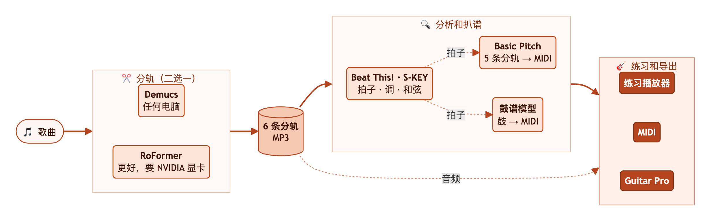
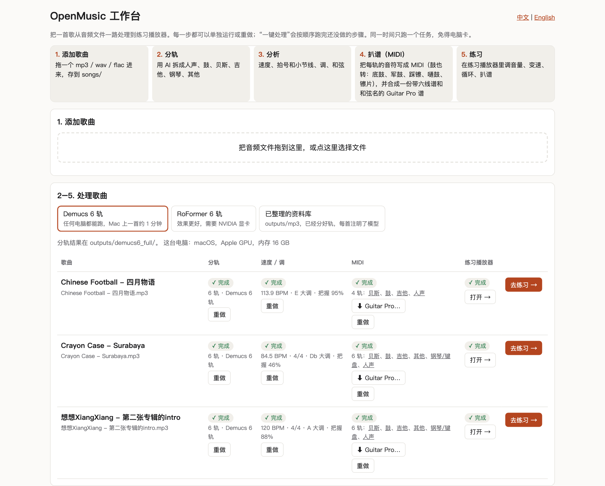
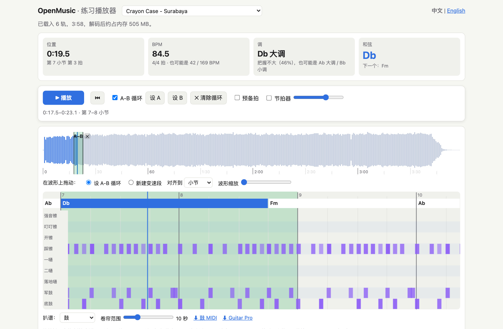
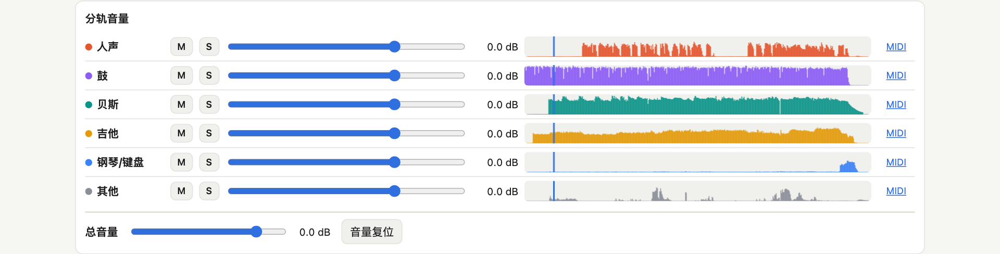

# OpenMusic

**中文** | [English](README.en.md)

> 本项目使用中文作为默认语言，同时也为英文使用者做了语言适配：英文说明见 [README.en.md](README.en.md)，工作台和练习播放器网页的右上角也可以进行自由的双语切换「中文 / English」。
>
> This project uses Chinese as its default language and also supports English: see [README.en.md](README.en.md) for the English README, and switch the language of the workbench and practice-player pages with "中文 / English" at the top right.

OpenMusic 是一个给乐手用的开源**练琴**、**扒谱**小工具：把一首歌拆成人声 / 鼓 / 贝斯 / 吉他 / 钢琴 / 其他 6 条音轨，使用**本地 HTML 网页**作为可视化工具，用户可以在里面自由地调节音量、变速、循环、看和弦、转 MIDI……（更多功能有待开发，期待更多的用户反馈）本项目目前还处于初期的开发阶段，使用 Python 语言搭建，在自己电脑上本地运行，尚未完成手机版本适配，尚未完成云端网页部署。

## 整体流程



整体流程是：使用「[**工作台**](#工作台)」把这几步串在一起，一首歌点一下「**一键处理**」就跑完；每一步也可以单独重做，或者在终端里一条条运行（见下面「[**练习播放器**](#练习播放器练琴扒谱用)」一节）。

- **第一步：输入音频分轨** 歌曲音频文件作为输入，然后使用 [Demucs](https://github.com/adefossez/demucs) 6 轨（任何电脑都能跑）或 [BS-RoFormer-SW](https://huggingface.co/enerjazzer/BS-ROFO-SW-Fixed) 6 轨（效果更好，建议用 NVIDIA 显卡，自测 RTX 4070 Ti 上一首大约 20 秒；Mac 上也能跑，但很慢，还要 6 GB 以上内存）音频分轨模型，将整首歌拆成**人声**、**鼓**、**贝斯**、**吉他**、**钢琴/键盘**和**其他** 6 条 MP3。分轨只读原曲音频文件，之后的每一步都**只读**分轨文件（导出 Guitar Pro 选「原曲」时会原样读取原曲），不会改动任何音频。
- **第二步：音频分轨分析** [Beat This!](https://github.com/CPJKU/beat_this) 找拍子和小节，[S-KEY](https://github.com/deezer/skey) 结合调性模板判断调，模板匹配 + [Viterbi 算法](https://zh.wikipedia.org/wiki/维特比算法)识别和弦。
- **第三步：音频分轨扒谱** **人声**、**贝斯**、**吉他**、**钢琴/键盘**和**其他** 5 条分轨用 **[Basic Pitch](https://github.com/spotify/basic-pitch)** 工具实现 MP3 转 MIDI；**鼓**用自带的鼓谱模型，或使用可选外挂模型 **[ADTOF-pytorch](https://github.com/xavriley/ADTOF-pytorch)**（效果更佳，但它的模型权重只能非商业使用，和本项目的 AGPL-3.0 协议不兼容，所以不随项目发布；本项目提供安装方法，见「[可选外挂](#可选外挂adtof-pytorch-扒鼓)」，装好后会自动使用）来实现 MP3 转 MIDI。本项目随后也提供了 MIDI 转 [Guitar Pro](https://www.guitar-pro.com/) 的生成代码，因此在MIDI转换完毕后，可以直接一键生成 Guitar Pro 乐谱工程文件（见「[Guitar Pro 谱](#guitar-pro-谱)」）。转 MIDI 的时候，我们会用到**第二步**分析得到的**拍子**和**小节线**（图中的虚线「拍子」），所以 MIDI、Guitar Pro 谱和练习播放器的小节线都是对齐的。只是歌曲第一个重拍之前的那一小段（弱起）在播放器里叫第 0 小节，在 MIDI 和 Guitar Pro 里是第 1 小节，所以那边的小节号通常比播放器大 1（见「[Guitar Pro 谱](#guitar-pro-谱)」）。
- **第四步：练习播放器和乐谱导出** 练习播放器直接播放分轨的音频，我们不仅提供每条分轨的音量调节、静音和独奏，还提供了循环、变速等功能（详见「[**练习播放器**](#练习播放器练琴扒谱用)」一节），极大地方便了乐手练琴！导出 Guitar Pro 谱时，还可以在谱里垫一条分轨混成的音频轨，下载时选择，默认人声 + 吉他 + 其他（图中的虚线「音频」）。

## 快速开始

1. 按下面「[安装](#安装)」一节装好环境。
2. 打开工作台：在访达里双击项目文件夹里的 **`OpenMusic.command`**（Windows 上双击 **`OpenMusic.bat`**）。会弹出一个终端窗口，浏览器自动打开 http://localhost:8780 ；工作台已经开着的话，只是在浏览器里打开它。也可以在终端里运行 `.venv/bin/python experiments/app.py`。
3. 把一首 mp3 拖进网页，选一个分轨模型，点「一键处理」，处理完点「打开」进入练习播放器。

**日常使用**：
- 想处理的歌直接放进 `songs/` 文件夹就行，几秒内会出现在工作台里；放了好几首时，先选好分轨模型，再点列表上方的「全部一键处理」，它们会一首接一首处理，一次只跑一个任务。
- 分好的音轨是 MP3（一首歌 6 轨加上分析、MIDI 和 Guitar Pro 谱大约 15–70 MB）；要无损的 FLAC，在终端里运行 `.venv/bin/python experiments/evaluate_multi.py demucs6 --full --no-score --lossless`（用 RoFormer 就把 `demucs6` 换成 `roformer_sw`；工作台里没有这个选项）。
- 用完关掉那个终端窗口（或在里面按 Ctrl+C），工作台就停了；正在跑的任务也会停下，下次在中断的那一步点「运行」（做过的步骤按钮叫「重做」），后面的步骤再点「一键处理」接着做。
- 可以把 `OpenMusic.command` 拖到程序坞右侧，或者在桌面放一个它的替身，以后点一下就打开。如果是从 GitHub 下载的 zip，macOS 第一次可能不让打开：在「系统设置 → 隐私与安全性」里点「仍要打开」（较早的 macOS 上也可以按住 Control 点它，选「打开」）。

## 工作台

工作台把整条流程串成一个网页，每一步都可以单独运行或重做，同一时间只跑一个任务，免得电脑卡：



1. **添加歌曲**：把 <mark>**mp3** / **wav** / **flac**</mark>（也支持 m4a、aac、ogg，单个文件最大 400 MB）拖进来，存到 `songs/`。
2. **分轨**：选模型（见下面「[分轨模型怎么选](#分轨模型怎么选)」），拆成 6 轨。每首歌会记下用的是哪个模型。
3. **分析**：速度（拍子、拍号、小节线）、调、和弦。
4. **扒谱（MIDI）**：每轨转成音符，鼓也转成鼓谱，可以导入 Guitar Pro / [MuseScore](https://musescore.org/)；同时合成一份整首歌的 Guitar Pro 谱，点「⬇ Guitar Pro…」选好谱里垫的音频轨就能下载（见下面「[Guitar Pro 谱](#guitar-pro-谱)」）。
5. **练习**：点「打开」进入这首歌的练习播放器；播放器左上角可以回到工作台。

「已整理的资料库」这个标签里是已经分好轨的歌（`outputs/mp3/`），直接从第 3 步开始。工作台只在本机运行（127.0.0.1），按钮背后就是下面「[练习播放器](#练习播放器练琴扒谱用)」一节里的那几条命令。

## 练习播放器（练琴、扒谱用）

歌分好轨以后，在本地网页里练：





- **每轨音量**：−∞ 到 +12 dB，可以把贝斯调得比原曲还响；静音、独奏；总音量带限幅器，调大也不会破音。
- **速度、调式、和弦**：自动识别 BPM、每一拍和小节线；调式给出把握程度，把握不到一半时再给出另外一两种可能（常见的是关系大小调）；时间轴上显示和弦，并提示当前和下一个和弦。
- **变速不变调**：50%–150%，可以在波形上拖出一段单独设速度，比如难的段落放慢到 70%；也能变调（± 半音和音分）。
- **练习工具**：A-B 循环（在波形上拖一段，或边听边按「设 A」「设 B」，默认对齐到最近的小节线；按 Esc、点 ✕ 或双击循环就能清除）、速度练习（默认从 70% 开始，每循环一遍加快 5%，到 100% 为止，都可以改；关掉后回到原来的速度）、预备拍、跟着歌曲拍子响的节拍器。每首歌的设置会记在这个浏览器里（工作台和 `http.server` 是不同的网址，各记各的），重新打开时会提示恢复了哪些；「本曲恢复默认」（确认后）把循环、变速段、速度、变调、音量、节拍器和预备拍恢复默认。
- **扒谱**：每轨自动转成 MIDI，网页里有钢琴卷帘，显示音名和"正在响"的音。MIDI 带歌曲的速度变化，每一拍、每条小节线都和播放器里的一样，导入 Guitar Pro / MuseScore 时小节能对上。贝斯最准，吉他、钢琴是比较密的参考草稿。识别模型对某首歌整体没把握时（比如特别低的合成器贝斯、失真很重的吉他），会自动放低这首歌这一轨的阈值，免得整段扒不出音。卷帘下面还能下载整首歌的 Guitar Pro 谱。
- **鼓谱**：鼓轨转成 [General MIDI](https://zh.wikipedia.org/wiki/General_MIDI) 鼓轨（底鼓、军鼓、踩镲和开镲、三个嗵鼓、强音镲、叮叮镲），网页里选「鼓」显示鼓谱视图，每种鼓件一行。底鼓、军鼓最准（真实录音分轨后 [F 值](https://zh.wikipedia.org/wiki/F1分数)约 0.9 / 0.8），踩镲是草稿，嗵鼓、镲片只作提示；装了可选外挂 ADTOF-pytorch（见下面「[可选外挂](#可选外挂adtof-pytorch-扒鼓)」）后踩镲、镲片明显更准。做法、选型和评测见 [docs/drums.md](docs/drums.md)。
- **快捷键**：空格 播放/暂停，L 循环开关，A / B 设循环起点 / 终点，Esc 清除循环，`[` `]` 调速 −/+5%，← → 跳到上一条 / 下一条小节线（没做分析时前后 2 秒），M 节拍器，Home 回到开头（开着循环时回到 A 点）。

最方便的是用上面的工作台。也可以在终端里一条条跑（以 RoFormer 分轨为例，`songs/` 里的每首歌都会处理）：

```bash
.venv/bin/python experiments/evaluate_multi.py roformer_sw --full --no-score
.venv/bin/python experiments/analyze.py outputs/roformer_sw_full
.venv/bin/python experiments/transcribe.py outputs/roformer_sw_full
.venv/bin/python experiments/export_gp.py outputs/roformer_sw_full
.venv/bin/python experiments/build_player.py outputs/roformer_sw_full
.venv/bin/python -m http.server 8765
```

然后浏览器打开 http://localhost:8765/outputs/roformer_sw_full/player.html （英文版 player.en.html，网页提供语言切换）。

- 必须通过本地服务器打开（工作台或 `http.server`）：直接双击 html 文件（file:// 地址），浏览器不允许运行播放器的音频处理模块。
- 第一条命令是分轨，`--no-score` 表示跳过 [MUSDB18](https://sigsep.github.io/datasets/musdb.html) 打分，所以不用先下载测试数据；第二条识别速度、调式、和弦；第三条转 MIDI；第四条生成 Guitar Pro 谱；第五条生成播放页。
- 识别结果是参考：噪音段、变速段里拍子容易跟丢，程序会按前后的速度把那里整理成整齐的小节，但位置不一定贴合音乐；调式和和弦的准确率大约七八成，和弦的扩展音（7、sus 等）只是提示。
- 一首 6 分多钟的 6 轨歌，浏览器里大约占 1.5 GB 内存。

## Guitar Pro 谱

转完 MIDI 后，工作台会接着生成整首歌的谱 `<歌名>/transcription/<歌名>.gp`（Guitar Pro 8 的 .gp 格式，Guitar Pro 7 见下面；中文歌名正常显示），不用再一轨一轨导入 MIDI、再手动整理。工作台的 MIDI 一栏和练习播放器（从工作台打开时，钢琴卷帘下面）都有「⬇ Guitar Pro…」：先选谱里垫的音频轨，再点「生成并下载」，几秒后文件下载到浏览器的下载文件夹，项目里不多存一份。用 `http.server` 打开的播放器里，那里是直接下载已生成的谱（默认音频轨）的链接。

- **音轨**：吉他（默认 6 弦标准调弦，六线谱 + 五线谱）、贝斯（默认标准 4 弦，六线谱 + 五线谱）、人声旋律（只有五线谱）；钢琴、其他轨要有足够多的音才放进去；有鼓的扒谱（`transcription/drums.mid`）时再加一条鼓轨。
- **小节**：和 MIDI、播放器用同一套拍子和小节线，拍号按每小节识别出的拍数写。歌曲开头不满一小节（弱起）时，它在 Guitar Pro 里是第 1 小节，在播放器里叫第 0 小节，所以后面的小节号比播放器大 1。如果歌曲开头到第一拍不到半拍（比如只有几十毫秒），谱里不给这一小段留拍子，直接从第一拍开始，音频轨跳过这一小段；不然 Guitar Pro 会把这一小段按整拍演奏，MIDI 声部就会比录音晚一拍。Guitar Pro 同一时间只能记一个整数速度，谱上写的是每小节的速度（取前后 5 小节的中位数），和当前写着的速度相差超过 3% 才标新速度；有音频轨时，播放速度由它的同步点决定，谱跟着录音走。
- **节奏**：音符对齐到十六分音符；明显是三连音的拍子对齐到八分三连音；鼓的快速双击（同一个鼓两下相隔约一个三十二分音符）写成两个三十二分音符，不会合成一下。同时开始的音合成一个和弦，最多持续到下一个音开始；不到半拍的空隙（人声旋律不到一拍）会补上，谱面少些零碎的休止符。
- **品位**：给每个和弦找出所有能按的指法（每根弦一个音，按弦的手指跨度吉他不超过 4 品、贝斯不超过 3 品），再用[动态规划](https://zh.wikipedia.org/wiki/动态规划)选出整首歌左手移动最少、弦序不交叉（高的音不放在比低的音更粗的弦上）的一条路线，长音之后换把位的代价小一些，最后稍微偏向低把位。实在按不下的音，去掉最轻的。比最低弦低一两个半音的音（D、D#）有 8 个以上、并且占到 1% 时，吉他或贝斯改用 Drop D 调弦。
- **清理**：去掉力度不到这一轨较响音符（95 百分位）55% 的轻音（鼓轨不做这一步）；吉他、钢琴、其他轨还去掉泛音造成的"鬼音"：比同时响着的另一个音高八度、十二度、两个八度……（到第 6 泛音），力度不到它 80%，而且至少一半时间和它重叠的音。
- **和弦名、调、标题**：分析出的和弦名写在谱表上方；歌名、艺人、调、速度写在文件信息里。
- **音频轨（可以选）**：谱里垫一条录音，在 Guitar Pro 8 里是一条音频轨。默认是**人声 + 吉他 + 其他**三条分轨的混音：贝斯、鼓、人声旋律的 MIDI 扒得准，由 Guitar Pro 按谱演奏；吉他要靠耳朵听，所以用真实录音。下载时也可以改成：任意勾选几条分轨混音；整首原曲（`songs/` 里的那个文件，原样放进去，不重新编码；没有原曲、或者是 Guitar Pro 8 读不了的格式，比如 .aac，就改放全部分轨的混音）；或者不放音频（文件最小，约 0.1 MB）。上次的选择会记在这个浏览器里。每小节开头有一个同步点，位置取自识别出的小节线，所以谱里的每一小节都和播放器里的同一小节对齐（有弱起时小节号差 1，见上），播放时谱和录音一起走（已在 Mac 上的 Guitar Pro 8 里试过）。分轨混音会整体调小音量，让峰值不超过 −1 dBFS（不会调大），不会爆音。命令行：`export_gp.py <曲库> --song <歌名> --audio stems --stems vocals,guitar,other`（默认），`--audio original` 放原曲，`--audio none` 不放；`--out <文件>` 写到别处，不动歌曲文件夹。
- **电吉他默认静音**：吉他的扒谱比较乱，所以这一轨一打开就是静音的，谱照常显示；贝斯、鼓、人声照常发声。在 Guitar Pro 的调音台里可以取消静音。
- **音频轨没声音时**：先在 Guitar Pro 8 里自己导入一段音频试试，多半是声音输出的问题。我们遇到过用蓝牙耳机（AirPods）时 Guitar Pro 8 完全不出声、换成电脑扬声器就好了的情况。音频轨那一行的红色耳机是「独奏」，开着时其他轨都听不到。
- 这仍然是草稿：贝斯最准，吉他比较密，要靠耳朵核对。文件名保留原来的歌名（下载的文件会在后面加上所选的音频，比如「歌名 (人声 吉他 其他).gp」）；音轨名和和弦名都是英文字母。
- 做法：先用 [PyGuitarPro](https://github.com/Perlence/PyGuitarPro) 在内存里把谱排好，再用 [alphaTab](https://github.com/CoderLine/alphaTab)（收录在 `experiments/vendor/alphatab/`，通过 [mini-racer](https://github.com/bpcreech/PyMiniRacer) 在 Python 里运行，不需要 Node.js 或浏览器）写成 .gp，然后读回检查歌名、小节、速度、每轨的音符、静音的轨、音频轨和每个同步点。不用旧的 .gp5 格式：Guitar Pro 读它的文字时用单字节编码（Mac 上也一样），中文歌名会变成乱码。
- Guitar Pro 7：文件按 Guitar Pro 8 的格式写（alphaTab 导出的都是这样），Guitar Pro 7 没有音频轨，看不到垫的那条音频轨。按文件里写的最低版本号，最新的 Guitar Pro 7 应该能打开谱，但这里没有 Guitar Pro 7，没有实际试过；有问题时用 `--audio none` 生成不带音频的谱。

单独运行：`.venv/bin/python experiments/export_gp.py outputs/mp3 --song "歌名"`（换音频要加 `--force`，例如只垫人声：`--audio stems --stems vocals --force`）。

## 分轨模型怎么选

工作台里有两个分轨模型可选：

| 模型 | 分得多干净（MUSDB18 测试片段 SDR，越高越好） | 速度 | 建议 |
|---|---|---|---|
| BS-RoFormer-SW 6 轨 | 平均 10.3 dB（人声 12.0、鼓 11.9、贝斯 9.4、其他\* 8.0） | RTX 4070 Ti 上一首约 20 秒；Mac 上很慢，还要 6 GB 以上内存 | 有 NVIDIA 显卡时首选 |
| Demucs 6 轨 | 平均 7.8 dB（人声 8.6、鼓 9.5、贝斯 8.3、其他\* 4.8） | Mac（M2 Pro）上分一首 4 分钟的歌约 20 秒（不算载入模型和写文件） | 任何电脑都能跑 |

\*「其他」是把吉他、钢琴和其他三轨加起来，和 MUSDB18 的「其他」比较；平均是四项的平均。MUSDB18 里没有单独的吉他、钢琴标准答案，这两轨只能靠耳朵比较。完整的实验记录（6 种传统信号处理方法和 AI 模型的分数，以及怎么在本机生成对比试听页）见 [docs/experiments.md](docs/experiments.md)。

## 与 Ultimate Vocal Remover（UVR）的比较

[UVR](https://github.com/Anjok07/ultimatevocalremovergui) 是最流行的开源分轨软件。下面只比较两者的功能定位（截至 2026 年 10 月）：

| | UVR | OpenMusic |
|---|---|---|
| 定位 | 分轨工作站：用多种模型产出高质量的分轨文件，供混音、翻唱、制作使用 | 练习工具：分完直接在本地网页里静音、独奏、对比着听，供乐手练琴使用 |
| 形式 | 桌面应用，提供 Windows / macOS / Linux 安装包 | Python + 本地网页（工作台 + 练习播放器） |
| 模型 | 多种架构（VR、MDX-Net、MDX23C、Demucs 等），除 Demucs 外大多由 UVR 开发者训练 | Demucs 6 轨、BS-RoFormer-SW 6 轨（另有传统信号处理方法的对比实验） |
| 多模型合并 | 有（Ensemble） | 传统方法有融合（`combo`），AI 模型暂时没有 |
| 质量评估 | 靠用户自己试听 | 内置打分（MUSDB18 测试片段上的 SDR）和对比试听页，见[实验记录](docs/experiments.md) |
| 变速、变调 | 提供基于 [Rubber Band](https://breakfastquay.com/rubberband/) 的处理工具，处理后输出文件 | 播放时实时调整，不同段落可以设不同速度 |
| 吉他 | 可用 Demucs 6 轨分出一条吉他轨，没有区分多把吉他的模型 | 同样是一条吉他轨（Demucs 6 轨或 RoFormer-SW） |
| 练琴、扒谱辅助 | 没有 | 每轨音量可放大、A-B 循环、节拍器；自动识别速度、调式、和弦；每轨转 MIDI 并显示钢琴卷帘；整首歌的 Guitar Pro 谱 |
| 输出 | 分轨文件 | 分轨（成品默认 MP3，对比用无损 FLAC），以及每轨 MIDI、整首歌的 Guitar Pro 谱、练习播放器网页 |
| 协议 | 代码 MIT（使用其模型需注明 UVR） | AGPL-3.0 |

两者是互补的：想要尽可能多的模型、尽可能好的分轨文件，用 UVR；想分完直接练琴、扒谱，并客观比较不同方法，用 OpenMusic。

## 目录

```
OpenMusic.command     双击启动工作台（macOS）；OpenMusic.bat 是 Windows 版
experiments/
  app.py              工作台：一个本地网页，一步步把歌处理到练习播放器
  common.py           路径、读写音频、SDR 打分
  prepare_data.py     把 MUSDB18 样例解成 3 轨标准答案（data/gt/）
  prepare_bass.py     补上贝斯标准答案
  make_excerpts.py    用 Demucs 分整首歌，并截一段 60 秒试听片段
  evaluate.py         给 3 轨方法打分：python experiments/evaluate.py <方法> --split test --song
  evaluate_multi.py   给多轨模型打分，也负责分整首歌（工作台的「分轨」就是调用它）：python experiments/evaluate_multi.py <模型> --split test --song --full
  verify_scores.py    从头重新打分，和已存的结果对比
  export_mp3.py       把已有的无损分轨（WAV/FLAC）转成 MP3，保持文件夹结构
  oracle.py           理论上限（理想频谱遮罩）
  build_page.py       生成对比试听页 compare.html（中文）和 compare.en.html（英文）
  analyze.py          识别速度（拍子、小节）、调式、和弦，写 analysis.json
  transcribe.py       每轨转 MIDI 和音符列表（transcription/）
  drums.py            鼓轨转鼓谱：找起音，小神经网络判断鼓件（transcribe.py 调用）
  train_drums.py      训练和评测 drums.py 的模型（E-GMD、合成鼓；MDB Drums 评测）
  drum_synth.py       合成鼓和节奏型：鼓谱测试和一部分训练数据
  models/             我们自己训练的模型权重：drums.npz
  export_gp.py        把各轨扒谱合成一个 Guitar Pro 谱（transcription/<歌名>.gp）
  gp7.py              用 alphaTab 写出 Guitar Pro 7/8 的 .gp，并读回检查
  build_player.py     生成练习播放器 player.html（中文）和 player.en.html（英文）
  tests/              分析、转谱、鼓谱、Guitar Pro 导出、播放器的自动测试
  vendor/             直接收录的第三方代码（各自带 LICENSE）：Signalsmith Stretch、wavesurfer.js、S-KEY、alphaTab
  methods/            3 轨方法：每种方法一个文件，提供 separate(mix, sr)；*_fit.py 用训练片段拟合参数，存进 *_stats.npz
  methods_multi/      多轨 AI 模型：demucs4、demucs6、roformer_sw
results/              每个方法的分数（JSON）和实验说明 method_info.json
docs/                 实验记录（分轨方法对比、鼓转 MIDI）和复现步骤，中英文各一份；flow/ 是 README 的流程图（render.py 生成），screenshots/ 是 README 的截图（shoot.py 生成）
```

不进仓库的（见 `.gitignore`）：`.venv/`、`.cache/`（模型权重）、`data/`（数据集）、`songs/`（你的歌）、`outputs/`（分好的音轨）、`plugins/`（自己装的可选外挂），以及生成的对比试听页 `compare.html`、`compare.en.html`。

## 安装

需要 Python 3.12 以上（requirements.txt 里固定的 numpy、scipy、librosa 等版本都要求 3.12；测试用的是 3.12.8）。

macOS / Linux：
```bash
python3 -m venv .venv
.venv/bin/pip install -r requirements.txt
.venv/bin/pip install --no-deps -r requirements-nodeps.txt
```

Windows + NVIDIA 显卡（例如 4070 Ti）：先运行下面第一行建好 `.venv`，再按 [PyTorch 官网的安装页](https://pytorch.org/get-started/locally/) 选 CUDA 版本，
把它给出的命令里的 `pip3` 换成 `.venv\Scripts\python -m pip`，装上带 CUDA 的 torch，最后运行后两行装其余依赖：
```bash
python -m venv .venv
.venv\Scripts\python -m pip install -r requirements.txt
.venv\Scripts\python -m pip install --no-deps -r requirements-nodeps.txt
```
装完检查 GPU：`.venv\Scripts\python -c "import torch; print(torch.cuda.is_available())"` 应该打印 `True`。
分轨模型会自动按 CUDA → Apple MPS → CPU 的顺序选设备（识别拍子、调和转 MIDI 都在 CPU 上跑）。

最后一行单独装转 MIDI 用的 basic-pitch：它的依赖声明要求的 TensorFlow 版本在 Python 3.12 上装不了，而我们用的 ONNX 方式根本不需要 TensorFlow，所以跳过依赖安装。之后 `pip check` 会报 basic-pitch 的依赖不满足（macOS 上 3 条，Windows / Linux 上 2 条），属于正常。
只有想跑播放器的自动测试、或者重画 README 的流程图和截图（`docs/flow/render.py`、`docs/screenshots/shoot.py`）时，才需要 `requirements-dev.txt`（Playwright，安装说明写在文件里）。

下面的命令都以 macOS 写法为例；Windows 把 `.venv/bin/python` 换成 `.venv\Scripts\python`。

模型权重第一次运行时会自动下载到 `.cache/`（Demucs 6 轨约 55 MB，复现实验用的 4 轨 htdemucs 约 85 MB，RoFormer-SW 约 700 MB，识别拍子的 Beat This! 约 8 MB）。

**分轨的文件格式：**
- 整首歌的分轨（`--full`）是拿来练习的成品，默认存成 **MP3**（VBR 约 V2，大小约为无损的 1/3，听感无差别）。加 `--lossless` 存成无损 FLAC。
- 60 秒对比片段（`--song`）是用来对比方法的，**一律是无损 FLAC**，因为压缩痕迹会盖住方法之间的差别。
- 已有的无损分轨想转 MP3：`.venv/bin/python experiments/export_mp3.py <无损分轨文件夹> <输出文件夹>`。
- 所有格式的分轨长度都精确到采样点，几轨一起播放时保持同步。

分轨方法的对比实验（要下载 MUSDB18 测试数据）怎么复现，见 [docs/experiments.md](docs/experiments.md)。

## 可选外挂：ADTOF-pytorch 扒鼓

OpenMusic 自带的鼓谱模型不用另外安装（见 [docs/drums.md](docs/drums.md)）。如果想让鼓谱更准，可以自己装一个外挂：[ADTOF-pytorch](https://github.com/xavriley/ADTOF-pytorch)，它是 Xavier Riley 把 Zehren 等人的 ADTOF 鼓谱模型移植到 PyTorch 的版本。装好以后，`transcribe.py` 和工作台会自动改用它来找鼓的每一下，再由 OpenMusic 自己的模型细分（哪个嗵鼓、开镲还是闭镲、强音镲还是叮叮镲）并估力度。结果写进同一个 `drums.mid`，`drums.notes.json` 里的 `"backend"` 会写成 `"adtof-pytorch"`。

**它更准**：真实录音（[MDB Drums](https://github.com/CarlSouthall/MDBDrums) 测试集，用 Demucs 从混音里分出的鼓轨），F 值对比如下（ADTOF 的权重训练时可能见过 MDB Drums，外挂的分数可能偏高一些，见 [docs/drums.md](docs/drums.md)）：

| | 底鼓 | 军鼓 | 踩镲 | 嗵鼓 | 镲片 | 叮叮镲 |
|---|---|---|---|---|---|---|
| 自带模型 | 0.90 | 0.82 | 0.64 | 0.16 | 0.49 | 0.43 |
| 外挂 ADTOF-pytorch | 0.94 | 0.83 | 0.79 | 0.30 | 0.83 | 0.74 |

在电子鼓录音（[E-GMD](https://magenta.tensorflow.org/datasets/e-gmd)）上反而是自带模型更好，合成鼓上两者差不多，详见 [docs/drums.md](docs/drums.md)。

**协议，请先看**：ADTOF-pytorch 不是 OpenMusic 的一部分，不随 OpenMusic 发布，也不放进仓库（`plugins/` 在 `.gitignore` 里）。OpenMusic 只在另一个进程里运行它的命令行、读它写出的 MIDI 文件，不导入它的代码。它的仓库目前没有 LICENSE 文件；作者在 [issue #3](https://github.com/xavriley/ADTOF-pytorch/issues/3) 里说代码会用 MIT 协议，模型权重来自原版 ADTOF，仍然是 [CC BY-NC-SA 4.0](https://creativecommons.org/licenses/by-nc-sa/4.0/)，也就是**只能非商业使用**。装不装、怎么用由你自己决定，并由你自己负责遵守它的协议；这里写的不是法律意见。

**安装**（在 OpenMusic 文件夹里运行；要下载约 1 GB，主要是 PyTorch）：

macOS / Linux：
```bash
git clone https://github.com/xavriley/ADTOF-pytorch plugins/ADTOF-pytorch
python3 -m venv plugins/ADTOF-pytorch/.venv
plugins/ADTOF-pytorch/.venv/bin/pip install -e plugins/ADTOF-pytorch
```

Windows：
```bash
git clone https://github.com/xavriley/ADTOF-pytorch plugins\ADTOF-pytorch
python -m venv plugins\ADTOF-pytorch\.venv
plugins\ADTOF-pytorch\.venv\Scripts\python -m pip install -e plugins\ADTOF-pytorch
```
有 NVIDIA 显卡的话，可以先按 [PyTorch 官网的安装页](https://pytorch.org/get-started/locally/) 把带 CUDA 的 torch 装进这个 venv；不装也行，它在 CPU 上一首歌只要几秒到十几秒。

- 装在别的地方：把环境变量 `OPENMUSIC_ADTOF` 设成它的 `adtof` 命令的完整路径（Windows 上是 `...\Scripts\adtof.exe`）。
- 装好后重新转鼓：`.venv/bin/python experiments/transcribe.py outputs/mp3 --stems drums`（换了外挂的歌会自动重做），或在工作台里点「MIDI」一栏的「重做」（会重做这首歌的所有轨）。
- 临时不用它：加 `--drums builtin`；一定要用它（没装就报错）：`--drums adtof`。卸载：删掉 `plugins/ADTOF-pytorch` 文件夹。
- 外挂出错时会提示，并自动改用自带模型。

## 许可和注意事项

- Copyright (C) 2026 Lihan Zhong。代码采用 GNU Affero 通用公共许可证 v3.0（AGPL-3.0，见 [LICENSE](LICENSE)）。任何人都可以使用、修改、再发布，但衍生项目只要发布出去，也必须以 AGPL-3.0 开源。**把修改后的版本做成网站等网络服务提供给别人用，也要向用户公开源代码。**
- MUSDB18 数据只能用于非商业的教育和学术用途，所以不放进仓库。`*_stats.npz` 和 `experiments/methods/stereo.py` 里的增益表，是从它的训练集学出来的参数（最大的 nmf_stats.npz 是约 120 万个数的 NMF 模板），适用 MUSDB18 的条款，不属于 AGPL 范围。
- Demucs 的模型权重不在 MIT 协议范围内，作者说明“仅供科学研究用途”（[facebookresearch/demucs#327](https://github.com/facebookresearch/demucs/issues/327)）。BS-RoFormer-SW 是社区流传的权重，训练者和协议都不明。个人练习可以，**不要拿去商用**。
- `experiments/models/drums.npz` 是我们用 `experiments/train_drums.py` 训练的权重，训练数据是 E-GMD（CC BY 4.0，需注明出处，见「[致谢](#致谢)」）和程序合成的鼓。评测用的 MDB Drums 是 CC BY-NC-SA 4.0，只在本机评测，没有用来训练，也不放进仓库。
- 不要把别人的歌或分好的音轨提交进仓库。
- `experiments/vendor/` 里收录的第三方代码保留各自的协议（MIT / BSD-3-Clause / MPL-2.0），见各目录的 LICENSE。S-KEY 只能从仓库里收录的这份用，**不要** `pip install skey`，那是一个不相干的同名包。

## 致谢

这个项目建立在很多开源项目和研究成果之上，在此致谢。

**分离模型和代码**

- [Demucs](https://github.com/adefossez/demucs)：Alexandre Défossez / Meta AI，代码 MIT 协议（原仓库 [facebookresearch/demucs](https://github.com/facebookresearch/demucs) 已归档）。用到的 HTDemucs 模型出自 Rouard, Massa & Défossez, “Hybrid Transformers for Music Source Separation”, ICASSP 2023（[doi](https://doi.org/10.1109/ICASSP49357.2023.10096956)）；6 轨模型 htdemucs_6s 见 Demucs 的 README。
- [BS-RoFormer](https://github.com/lucidrains/BS-RoFormer)：Phil Wang (lucidrains) 的 PyTorch 实现，MIT 协议。架构出自 Lu, Wang, Kong & Hung, “Music Source Separation with Band-Split RoPE Transformer”, ICASSP 2024（[doi](https://doi.org/10.1109/ICASSP48485.2024.10446843)）。
- [bs-roformer-infer](https://github.com/openmirlab/bs-roformer-infer)：OpenMIRLab，MIT 协议；它改编自 lucidrains/BS-RoFormer 和 [python-audio-separator](https://github.com/nomadkaraoke/python-audio-separator)（Andrew Beveridge，MIT 协议）。
- BS-RoFormer SW 6 轨权重：最早由 jarredou 以 “BS-ROFO-SW-Fixed” 上传到 Hugging Face（原账号已删除），我们下载的是 [enerjazzer/BS-ROFO-SW-Fixed](https://huggingface.co/enerjazzer/BS-ROFO-SW-Fixed) 的镜像。训练者和协议均不明。它沿用 [Music-Source-Separation-Training](https://github.com/ZFTurbo/Music-Source-Separation-Training)（ZFTurbo，MIT 协议）的配置格式。

**数据和评测**

- MUSDB18：Rafii, Liutkus, Stöter, Mimilakis & Bittner, “The MUSDB18 corpus for music separation”, 2017（[doi:10.5281/zenodo.1117372](https://doi.org/10.5281/zenodo.1117372)）。7 秒样例来自 [sigsep/sigsep-mus-db](https://github.com/sigsep/sigsep-mus-db)。
- 打分用的全局 SDR 参照 Music Demixing Challenge：Mitsufuji et al., “Music Demixing Challenge 2021”, Frontiers in Signal Processing, 2022（[doi](https://doi.org/10.3389/frsip.2021.808395)）。我们的实现在细节上略有不同。

**传统信号处理方法参考的论文**

- 打击乐/和声分离：D. FitzGerald, “Harmonic/Percussive Separation using Median Filtering”, DAFx-10, 2010（[链接](https://dafx.de/paper-archive/details/DsmIVcydPX66AuaqEmKyTQ)）；D. FitzGerald & M. Gainza, “Single Channel Vocal Separation using Median Filtering and Factorisation Techniques”, ISAST Trans. on Electronic and Signal Processing 4(1), 2010（[链接](https://arrow.tudublin.ie/argart/8)）；J. Driedger, M. Müller & S. Disch, “Extending Harmonic-Percussive Separation of Audio Signals”, ISMIR 2014（[doi](https://doi.org/10.5281/zenodo.1415226)）。
- 重复结构：Z. Rafii & B. Pardo, “REpeating Pattern Extraction Technique (REPET): A Simple Method for Music/Voice Separation”, IEEE TASLP 21(1), 2013（[doi](https://doi.org/10.1109/TASL.2012.2213249)）；Z. Rafii & B. Pardo, “Music/Voice Separation using the Similarity Matrix”, ISMIR 2012（[doi](https://doi.org/10.5281/zenodo.1417631)）；D. FitzGerald, “Vocal Separation using Nearest Neighbours and Median Filtering”, ISSC 2012（[doi](https://doi.org/10.1049/ic.2012.0225)）。
- 旋律引导：J.-L. Durrieu, G. Richard, B. David & C. Févotte, “Source/Filter Model for Unsupervised Main Melody Extraction From Polyphonic Audio Signals”, IEEE TASLP 18(3), 2010（[doi](https://doi.org/10.1109/TASL.2010.2041114)）。
- 矩阵分解（NMF）：D. D. Lee & H. S. Seung, “Learning the parts of objects by non-negative matrix factorization”, Nature 401, 1999（[doi](https://doi.org/10.1038/44565)）；D. D. Lee & H. S. Seung, “Algorithms for Non-negative Matrix Factorization”, NIPS 13, 2000（[链接](https://papers.nips.cc/paper_files/paper/2000/hash/f9d1152547c0bde01830b7e8bd60024c-Abstract.html)）。
- 立体声位置：C. Avendano, “Frequency-domain source identification and manipulation in stereo mixes for enhancement, suppression and re-panning applications”, IEEE WASPAA 2003（[doi](https://doi.org/10.1109/ASPAA.2003.1285818)）；D. Barry, B. Lawlor & E. Coyle, “Sound Source Separation: Azimuth Discrimination and Resynthesis”（ADRess），DAFx-04, 2004（[链接](https://dafx.de/paper-archive/details/jK8kPFnlWXDwy1Kumk3kkQ)）。

**练习播放器与音乐分析**

- [Signalsmith Stretch](https://github.com/Signalsmith-Audio/signalsmith-stretch)（Geraint Luff / Signalsmith Audio，MIT）：变速不变调、变调的音频引擎。收录的是 1.3.2 版网页构建，打了两处小补丁，见 `experiments/vendor/signalsmith-stretch/README.md`。
- [wavesurfer.js](https://github.com/katspaugh/wavesurfer.js)（BSD-3-Clause）7.12.12：波形、时间轴和区域选择。
- 设计参考：[Woodshed](https://github.com/KyleKincer/woodshed)（MIT）的音频引擎设计，[BandBuddy](https://github.com/dourgey/BandBuddy)（Apache-2.0）的限幅器参数，[Steminize](https://github.com/Gerschwin/steminize)（MIT）的循环加速练习，[StemDeck](https://github.com/stemdeckapp/stemdeck)（Apache-2.0）用分轨识别调式和弦时的权重和 Albrecht–Shanahan 调式表。
- [Beat This!](https://github.com/CPJKU/beat_this)（CPJKU，ISMIR 2024；代码和权重都是 MIT）：识别拍子和小节。
- [S-KEY](https://github.com/deezer/skey)（Deezer，ICASSP 2025，MIT）：调式识别模型，收录在 `experiments/vendor/skey/`；依赖 [nnAudio](https://github.com/KinWaiCheuk/nnAudio)（MIT）。
- 调式模板数据取自 [Essentia](https://github.com/MTG/essentia) 的 key.cpp（AGPL-3.0）；和弦识别的模板 + Viterbi 做法参照 librosa 文档里的[示例](https://librosa.org/doc/0.11.0/auto_examples/plot_viterbi.html)。
- [Basic Pitch](https://github.com/spotify/basic-pitch)（Spotify，ICASSP 2022，Apache-2.0）：转 MIDI，用 [ONNX Runtime](https://github.com/microsoft/onnxruntime)（MIT）运行；MIDI 读写用 [pretty_midi](https://github.com/craffel/pretty-midi)（MIT）和 [mido](https://github.com/mido/mido)（MIT），评测用 [mir_eval](https://github.com/mir-evaluation/mir_eval)（MIT），重采样用 [resampy](https://github.com/bmcfee/resampy)（ISC）。
- E-GMD：L. Callender, C. Hawthorne & J. Engel, “Improving Perceptual Quality of Drum Transcription with the Expanded Groove MIDI Dataset”, 2020（[链接](https://magenta.tensorflow.org/datasets/e-gmd)，CC BY 4.0）：训练鼓谱模型 `experiments/models/drums.npz`。
- 可选外挂 ADTOF-pytorch（不随 OpenMusic 发布）：[ADTOF](https://github.com/MZehren/ADTOF)，M. Zehren, M. Alunno & P. Bientinesi, “ADTOF: A Large Dataset of Non-Synthetic Music for Automatic Drum Transcription”, ISMIR 2021；“High-Quality and Reproducible Automatic Drum Transcription from Crowdsourced Data”, Signals 4(4), 2023（[doi:10.3390/signals4040042](https://doi.org/10.3390/signals4040042)）；PyTorch 移植：Xavier Riley，[xavriley/ADTOF-pytorch](https://github.com/xavriley/ADTOF-pytorch)（权重 CC BY-NC-SA 4.0）。
- MDB Drums：C. Southall, C. Wu, A. Lerch & J. Hockman, “MDB Drums: An Annotated Subset of MedleyDB for Automatic Drum Transcription”, ISMIR 2017（[仓库](https://github.com/CarlSouthall/MDBDrums)，CC BY-NC-SA 4.0）：只用来评测鼓谱；音频来自 MedleyDB（R. Bittner et al., ISMIR 2014）。
- [PyGuitarPro](https://github.com/Perlence/PyGuitarPro)（Sviatoslav Abakumov，LGPL-3.0）：在内存里排好 Guitar Pro 谱；它依赖 [attrs](https://github.com/python-attrs/attrs)（MIT）。
- [alphaTab](https://github.com/CoderLine/alphaTab)（Daniel Kuschny 等，MPL-2.0）：把排好的谱写成 Guitar Pro 7/8 的 .gp，并读回检查；收录的是 1.8.4 版，未修改，见 `experiments/vendor/alphatab/README.md`。它在 [mini-racer](https://github.com/bpcreech/PyMiniRacer)（ISC，内含 [V8](https://v8.dev)，BSD-3-Clause）里运行。
- [Playwright](https://github.com/microsoft/playwright-python)（Apache-2.0）：只用于播放器的自动测试，以及生成 README 的流程图和截图。

**Python 库**

[PyTorch](https://github.com/pytorch/pytorch)（BSD-3-Clause）、[NumPy](https://github.com/numpy/numpy)（BSD-3-Clause）、[SciPy](https://github.com/scipy/scipy)（BSD-3-Clause）、[librosa](https://github.com/librosa/librosa)（ISC；McFee et al., SciPy 2015，[doi](https://doi.org/10.25080/Majora-7b98e3ed-003)）、[python-soundfile](https://github.com/bastibe/python-soundfile)（BSD-3-Clause）及其自带的 [libsndfile](https://github.com/libsndfile/libsndfile)（LGPL-2.1+，MP3 编解码用 LAME 和 mpg123）、[PyAV](https://github.com/PyAV-Org/PyAV)（BSD-3-Clause）及 [FFmpeg](https://ffmpeg.org)（LGPL；PyAV 安装包自带的这份按 LGPL-3.0+ 编译，另带 GPL 的 x264 / x265，都与 AGPL-3.0 兼容）、[scikit-learn](https://github.com/scikit-learn/scikit-learn)（BSD-3-Clause）、[Matplotlib](https://github.com/matplotlib/matplotlib)（Matplotlib License）、[ML Collections](https://github.com/google/ml_collections)（Apache-2.0）、[PyYAML](https://github.com/yaml/pyyaml)（MIT）。
